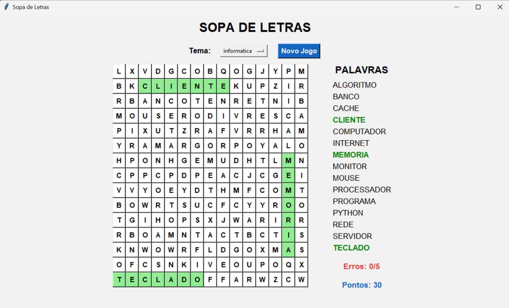

# 🔤 Sopa de Letras



Jogo de sopa de letras em Python com interface gráfica (Tkinter).

## Funcionalidades
- Tabuleiro 15x15 gerado aleatoriamente, com palavras em 8 direções
- Vários temas de palavras (ficheiros `.txt` na pasta `temas/`)
- Pontuação e limite de erros
- Botão de novo jogo e mudança de tema a qualquer momento

## Como jogar
Clique na **primeira** e na **última** letra de uma palavra da lista.
Cada acerto vale 10 pontos. Com 5 erros, o jogo reinicia.

## Como executar
Requer Python 3.7+ (o Tkinter já vem incluído na maioria das instalações).

```
python main.py
```

## Criar um novo tema
Crie um ficheiro `.txt` na pasta `temas/` com uma palavra por linha. Ele aparece automaticamente no menu.

## Estrutura
- `main.py` – ponto de entrada
- `interface.py` – janela e interação
- `gerador.py` – geração do tabuleiro
- `palavras.py` – leitura dos temas
- `configuracoes.py` – constantes (tamanho, cores, erros)

## Autor
Desenvolvido por **Araújo Morais**, finalista de Engenharia Informática.
🔗 [LinkedIn](https://www.linkedin.com/in/ara%C3%BAjo-morais-342900418)